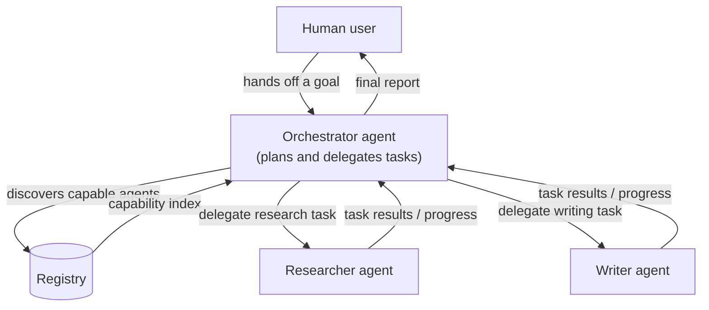
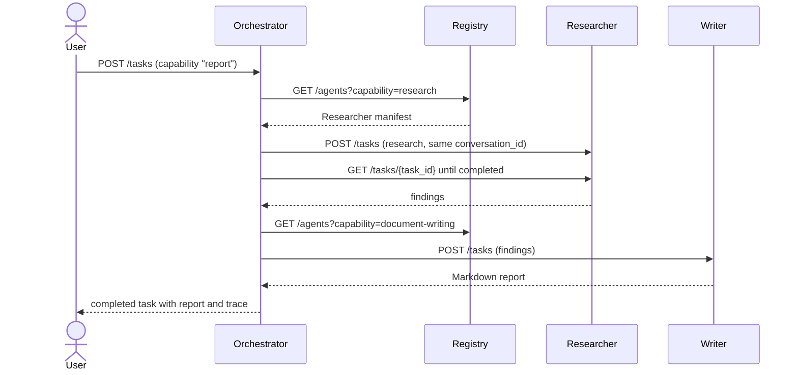
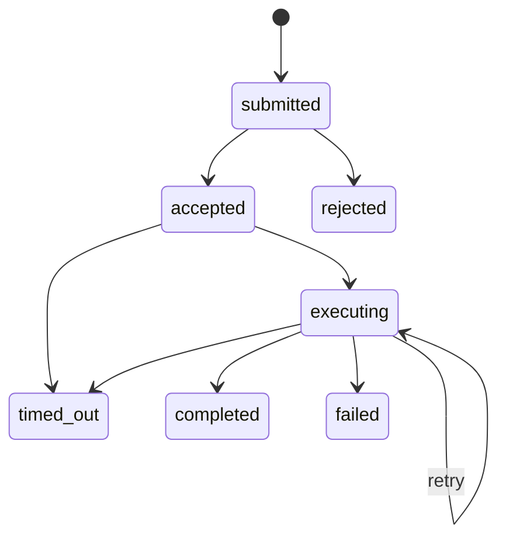

# AgentMesh

**An open protocol for peer-to-peer AI agent communication: capability discovery, task delegation and asynchronous collaboration between independent agents, with a dependency-light Python reference implementation.**

<p align="center">
  <a href="https://github.com/kirtanbhatt10/Agentmesh/actions/workflows/tests.yml"></a>
  <a href="LICENSE"></a>
  
  
  
  
  
  <a href="CONTRIBUTING.md"></a>
  <a href="https://github.com/kirtanbhatt10/Agentmesh/stargazers"></a>
</p>

---

AgentMesh lets independently deployed AI agents **publish what they can do, find each other, hand work to each other as peers and track that work to a result** — whatever model, framework or language each agent uses. Agents describe themselves with a JSON **manifest**, a **registry** indexes those manifests by capability, and work moves as **tasks** with a shared lifecycle (`submitted → accepted → executing → completed / failed / timed_out`, or `rejected`).

The `agentmesh` package gives you the draft protocol schemas and validators plus a working reference stack — agent server, registry, clients, CLI and a three-agent demo — that needs nothing beyond the Python standard library and `jsonschema`.

> ⚠️ **Status: alpha (v0.2.0).** The protocol schemas are **drafts** and may change. The reference services are for development, demos and trusted networks: they have **no authentication or TLS yet** and keep state in memory. See [SECURITY.md](SECURITY.md) and the [roadmap](docs/roadmap.md).

## Contents

- [Quick start](#quick-start)
- [Build an agent](#build-an-agent)
- [Command-line tool](#command-line-tool)
- [Run with Docker](#run-with-docker)
- [How it works](#how-it-works)
- [How AgentMesh differs from MCP](#how-agentmesh-differs-from-mcp-and-clientserver-tool-architectures)
- [Project status and roadmap](#project-status)
- [Development](#development)

## Quick start

```bash
pip install git+https://github.com/kirtanbhatt10/Agentmesh.git
agentmesh demo "How do agents discover each other?"
```

`agentmesh demo` starts a registry and three agents — an **Orchestrator**, a **Researcher** and a **Writer** — on free local ports. The Orchestrator looks the other two up in the registry by capability, delegates a research task and then a writing task over HTTP (sharing one `conversation_id`), and returns the assembled report:

```text
registry      http://127.0.0.1:41613
researcher    http://127.0.0.1:39221  (research)
writer        http://127.0.0.1:44107  (document-writing)
orchestrator  http://127.0.0.1:35089  (report)
conversation  conv-6f0c...

  research          -> urn:agentmesh:researcher  [completed]
  document-writing  -> urn:agentmesh:writer  [completed]

# How do agents discover each other?
...
```

The demo agents are deterministic and offline (no LLM or API key): the Researcher searches a small set of built-in notes about AgentMesh and the Writer formats them as Markdown. Swap their handlers for model calls to make them real.

## Build an agent

```python
from agentmesh import Agent, AgentClient, TaskFailure

agent = Agent("text-stats", version="1.0.0", description="Counts words.")


@agent.capability("text-statistics", input_hint='{ "text": string }')
def text_statistics(context, info):
    text = context.get("text")
    if not isinstance(text, str) or not text.strip():
        raise TaskFailure("invalid_context", "context.text must be a non-empty string")
    return {"words": len(text.split())}


with agent.serve(port=8001) as server:  # GET /manifest, POST /tasks, GET /tasks/{id}
    client = AgentClient(server.url)
    task = client.delegate("text-statistics", {"text": "agents talk to agents"})
    print(task["status"], task["result"]["data"])  # completed {'words': 4}
```

What the reference agent handles for you:

- **Manifest** generated from your capabilities and validated against the schema.
- **Asynchronous execution** on a worker pool; callers poll `GET /tasks/{task_id}` (`AgentClient.delegate()` does this for you).
- **Explicit rejection** of unknown capabilities, unsupported `output_format` and invalid or past deadlines.
- **Deadlines** from `deadline` / `timeout_seconds`, **retries** of `TaskFailure(..., retryable=True)` within `max_retries`, and **`max_result_bytes`**.
- **Structured errors** for anything that goes wrong, never a stack trace on the wire.
- **Idempotent** re-submission of the same task; `409` for a reused `task_id` with a different payload.
- **Registry membership** with `agent.serve(registry_url=...)`: register on start, heartbeat, unregister on shutdown.

A complete, runnable version is in [`examples/custom_agent.py`](examples/custom_agent.py). The HTTP binding, status codes and error codes are documented in [docs/http-api.md](docs/http-api.md).

### Validate payloads

```python
from agentmesh import validate_task

task = {"task_id": "t-1", "conversation_id": "c-1", "capability": "research", "context": {}}
for e in validate_task({**task, "status": "completed"}):
    print(e)  # $: 'result' is a required property
```

Each error carries a JSON path (`e.path`) and a message (`e.message`); an empty list means the payload is valid.

## Command-line tool

| Command | What it does |
| --- | --- |
| `agentmesh demo [TOPIC] [--json]` | Run the Orchestrator → Researcher → Writer demo locally. |
| `agentmesh registry [--host H] [--port 8500]` | Serve a registry. |
| `agentmesh demo-agent {researcher,writer,orchestrator} --registry URL [--port P]` | Serve one demo agent and register it. |
| `agentmesh discover AGENT_URL` | Fetch and validate an agent's manifest. |
| `agentmesh find REGISTRY_URL [--capability ID] [--json]` | List registered agents. |
| `agentmesh submit AGENT_URL FILE [--wait] [--timeout S]` | Submit a task payload, optionally waiting for the outcome. |
| `agentmesh validate {manifest,task} FILE...` | Validate JSON files against the schemas (`-` reads stdin). |
| `agentmesh schema {manifest,task}` | Print a JSON Schema. |

Run the demo as four separate processes, the way real agents would be deployed:

```bash
agentmesh registry --port 8500 &
agentmesh demo-agent researcher   --registry http://127.0.0.1:8500 --port 8501 &
agentmesh demo-agent writer       --registry http://127.0.0.1:8500 --port 8502 &
agentmesh demo-agent orchestrator --registry http://127.0.0.1:8500 --port 8503 &
agentmesh find http://127.0.0.1:8500
echo '{"task_id": "r-1", "conversation_id": "c-1", "capability": "report", "context": {"topic": "task lifecycle"}}' > task.json
agentmesh submit http://127.0.0.1:8503 task.json --wait
```

[`scripts/demo-cluster.sh`](scripts/demo-cluster.sh) does all of that and cleans up afterwards: `bash scripts/demo-cluster.sh "your topic"`.

## Run with Docker

```bash
docker build -t agentmesh:local .
docker run --rm agentmesh:local agentmesh demo           # self-contained demo
docker compose up --build --wait                         # registry + 3 agents on 127.0.0.1:8500-8503
agentmesh find http://127.0.0.1:8500
docker compose down
```

The image runs as a non-root user and stops cleanly on `docker stop` (agents unregister themselves).

## How it works

### Core concepts

1. **Unified JSON payload schema.** Tasks, conversations, results, errors and usage metadata share one draft schema ([`specs/task.schema.json`](specs/task.schema.json)) so agents can be mixed and matched.
2. **Discovery through manifests and registries.** Each agent serves `GET /manifest` ([`specs/manifest.schema.json`](specs/manifest.schema.json)); a registry indexes manifests so an Orchestrator can find a Researcher or Writer by capability. The registry is an advisory index, never a broker.
3. **Asynchronous task delegation.** A delegator submits a task and tracks it by `task_id` (and `conversation_id` across a workflow) until it reaches a terminal state, by polling today and webhooks later.

### Architecture



### Example flow: delegated research → report

This is the flow `agentmesh demo` runs:



### Task lifecycle



Details: [docs/task-lifecycle.md](docs/task-lifecycle.md) · [docs/protocol-overview.md](docs/protocol-overview.md) · [docs/agent-discovery.md](docs/agent-discovery.md) · [docs/architecture.md](docs/architecture.md) · [docs/http-api.md](docs/http-api.md)

## Vision and design principles

- **Model-agnostic:** the protocol does not depend on any particular LLM provider or model.
- **Language-agnostic:** the protocol is JSON over HTTP, so any language can participate; the Python package is a reference, not part of the contract.
- **Composable:** multi-agent workflows (e.g., an Orchestrator chaining specialist agents) are expressed with the protocol itself.
- **Asynchronous by default:** real agent work is long-running, so the protocol is built around task delegation, deadlines and eventual results rather than blocking calls.
- **Explicit over silent:** agents reject what they cannot honor and report failures as structured errors.
- **Honest scoping:** the docs describe what is proposed and what is implemented, and do not claim security or production readiness that has not been built and reviewed.

## How AgentMesh differs from MCP and client–server tool architectures

| Aspect | Traditional client–server / tool-calling (e.g., MCP) | AgentMesh |
| --- | --- | --- |
| Relationship | An *application* calls *tools* owned by it | Independent *agents* delegate tasks to peer agents |
| Discovery | Tools are enumerated by the host application | Agents publish manifests; discovery via manifests and registries |
| Coupling | Integrations are application-centric and bespoke | A standard protocol carries delegation, context, results and errors |
| Communication | Predominantly synchronous tool invocation | Asynchronous task lifecycle: submission, acceptance, execution, completion, failure, retries, timeouts |
| State | Session state lives in the host application | Task state and conversation correlation are explicit protocol concepts |

This is a framing, not a criticism of any specific standard: MCP is designed for application↔tool integration, while AgentMesh targets agent↔agent coordination, and both can coexist in the same system — an AgentMesh agent can use MCP tools internally.

## Project status

- ✅ Draft JSON Schemas for agent manifests and task payloads ([`specs/`](specs/README.md)), with conditional rules (`completed` ⇒ `result`; `rejected`/`failed`/`timed_out` ⇒ `error`).
- ✅ Validation API and CLI.
- ✅ Task lifecycle state machine.
- ✅ Reference agent server, registry and clients over HTTP, with deadlines, retries, idempotency and explicit rejection.
- ✅ Three-agent demo (Orchestrator, Researcher, Writer) in one process, as separate processes and in Docker Compose.
- ✅ Tests on Python 3.10–3.13, package build and Docker checks in CI.
- 🚧 LLM-backed reference agents, Redis-backed task state, webhooks: **planned**.
- 🚧 Authentication, authorization, TLS and observability: **planned (Phase 5)**.

## Roadmap

Details in [docs/roadmap.md](docs/roadmap.md):

- **Phase 0** — Repository scaffolding and architecture documentation. *(done)*
- **Phase 1** — Protocol specification and JSON schema. *(in progress: drafts published, open questions remain)*
- **Phase 2** — Minimal agent API and manifest discovery. *(reference implementation done)*
- **Phase 3** — Three-agent MVP: Orchestrator, Researcher, Writer. *(offline demo done; LLM-backed agents next)*
- **Phase 4** — Redis-backed task tracking and asynchronous communication. *(polling and timeouts done; Redis and webhooks next)*
- **Phase 5** — Authentication, authorization, observability, testing and security hardening.
- **Phase 6** — Multi-agent interoperability and external developer adoption.

Open specification questions — who assigns `task_id`, retry and idempotency semantics, the error-code taxonomy, capability matching and manifest versioning — are tracked in [docs/task-lifecycle.md](docs/task-lifecycle.md) and [docs/protocol-overview.md](docs/protocol-overview.md). The reference implementation's current answers are documented there too.

## Repository structure

```text
Agentmesh/
├── src/agentmesh/
│   ├── validation.py       # schema loading and payload validation
│   ├── lifecycle.py        # task states, transitions, payload helpers
│   ├── agent.py            # reference agent server
│   ├── registry.py         # reference registry
│   ├── client.py           # AgentClient, RegistryClient
│   ├── demo.py             # Orchestrator, Researcher, Writer demo agents
│   ├── cli.py              # the agentmesh command
│   └── _http.py            # stdlib JSON-over-HTTP plumbing
├── specs/                  # draft JSON Schemas (bundled into the package)
├── docs/                   # protocol, architecture, discovery, lifecycle, HTTP API, roadmap
├── examples/               # custom_agent.py and example payloads
├── tests/                  # pytest suite
├── scripts/                # demo-cluster.sh
├── agents/                 # reserved for production-oriented reference agents
├── Dockerfile, docker-compose.yml
└── .github/                # CI, release workflow, issue and PR templates
```

## Development

```bash
git clone https://github.com/kirtanbhatt10/Agentmesh.git
cd Agentmesh
python -m venv .venv && source .venv/bin/activate
pip install -e ".[dev]"
pytest -v
ruff check . && ruff format --check .
```

Contributions to the specification, documentation and code are welcome — please read [CONTRIBUTING.md](CONTRIBUTING.md), our [Code of Conduct](CODE_OF_CONDUCT.md) and [SECURITY.md](SECURITY.md).

## Releasing

1. Update the version in `pyproject.toml` and `src/agentmesh/__init__.py`, and move the "Unreleased" notes in [CHANGELOG.md](CHANGELOG.md) under the new version.
2. Commit, then tag and push: `git tag v0.2.0 && git push origin v0.2.0`.
3. The [release workflow](.github/workflows/release.yml) builds the package, publishes it to PyPI and creates a GitHub release.

One-time setup before the first release: on [pypi.org](https://pypi.org/manage/account/publishing/), add a *pending trusted publisher* for repository `kirtanbhatt10/Agentmesh`, workflow `release.yml`, environment `pypi`. No API token is needed.

## Maintainer

Maintained by [@kirtanbhatt10](https://github.com/kirtanbhatt10).

## License

This project is licensed under the MIT License — see [LICENSE](LICENSE).
