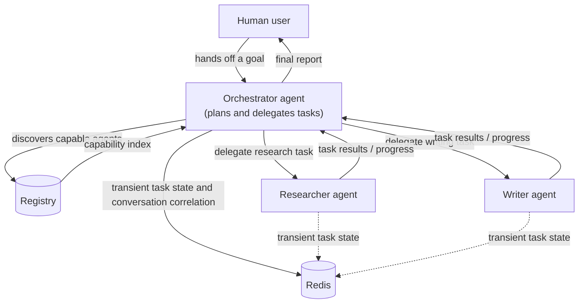
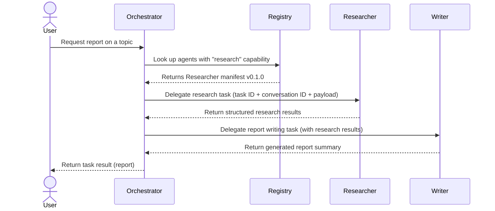

# AgentMesh

**A model-agnostic, language-agnostic communication protocol for independent AI agents.**

---

> ⚠️ **Status: Early design and repository scaffolding.** AgentMesh is currently a proposal. The specification, examples, and agents described in this repository are **planned, not yet implemented**. Nothing here is tested, production-ready, or supported.

## What is AgentMesh?

AgentMesh is a proposed **Agent-to-Agent (A2A) communication protocol** that lets independently deployed AI agents:

- **Discover capabilities** of other agents through manifests and registries.
- **Delegate tasks** to each other as peers.
- **Exchange structured context** using a unified payload schema.
- **Coordinate asynchronous workflows** across network APIs.

### The problem it aims to solve

Today, integrating an AI agent (or any LLM-powered service) into a workflow typically means building one-off, application-centric integrations: each agent speaks its own API dialect, state is coupled to each implementation, and composing multi-agent workflows requires custom glue code for every pair of agents. There is no shared, standardized way for independent agents to describe what they can do, hand work to each other, and track a task from submission to result.

AgentMesh aims to establish a standardized communication layer **between agents**, rather than between an agent and its tools. The goal is a common vocabulary for discovery, delegation, and task lifecycle so that agents built with different frameworks, models, and languages can interoperate.

## Vision and objectives

- **Model-agnostic:** the protocol does not depend on any particular LLM provider or model.
- **Language-agnostic:** the protocol is expressed over network APIs, so any language can participate; reference documentation and initial implementation direction may favor particular stacks (see below) without making that part of the contract.
- **Composable:** multi-agent workflows (e.g., an orchestrator chaining specialist agents) should be describable in terms of the protocol itself.
- **Asynchronous by default:** real agent work is long-running; the protocol is designed around task delegation, timeouts, and eventual results rather than synchronous request/response blocking.
- **Separate protocol from implementation:** the specification lives in `specs/`, while concrete agents and servers live in `agents/` and `examples/`.

## Design principles

1. **Simple payloads.** A single, unified JSON schema for tasks, context, results, and errors.
2. **Explicit discovery.** Agents are found via self-describing manifests (served by the agent itself) and optional registries.
3. **Asynchronous coordination.** Tasks are delegated with IDs and correlation IDs; callers poll or receive webhooks for progress.
4. **Honest scoping.** The protocol describes what is proposed; it does not claim security, decentralization, or production readiness that has not been built and reviewed.

## How AgentMesh differs from MCP and client–server tool architectures

| Aspect | Traditional client–server / tool-calling (e.g., MCP) | AgentMesh (proposed) |
| --- | --- | --- |
| Relationship | An *application* calls *tools* owned by it | Independent *agents* delegate tasks to peer agents |
| Discovery | Tools are enumerated by the host application | Agents publish manifests; discovery via manifests and registries |
| Coupling | Integrations are application-centric and bespoke | A standard protocol carries delegation, context, results, and errors |
| Communication | Predominantly synchronous tool invocation | Asynchronous task lifecycle: submission, acceptance, execution, completion, failure, retries |
| State | Session state lives in the host application | Task state and conversation correlation are explicit protocol concepts (with Redis as the planned transient-state backing) |

The comparison above is a framing, not a criticism of any specific standard: MCP is designed for application↔tool integration, while AgentMesh is proposed for agent↔agent coordination, and both can coexist in the same system.

## Core architectural pillars

1. **Unified JSON payload schema.** Tasks, conversations, results, errors, and usage metadata share one proposed schema so that agents can be mixed and matched.
2. **Agent discovery through manifests and registries.** Each agent exposes a `/manifest` endpoint describing its identity and capabilities; a registry indexes those manifests so an Orchestrator can find agents such as a Researcher or Writer by capability.
3. **Asynchronous task delegation and communication.** A delegator submits a task and tracks it via task IDs and conversation IDs, receiving progress and results through rest APIs plus webhooks or polling.

## Proposed architecture



## Example flow: delegated research → report

The following sequence diagram illustrates the *intended* interaction pattern (not an implemented flow):



## Planned technology stack

This is the *preferred initial implementation direction*, subject to confirmation:

- **Python + FastAPI** — initial preferred implementation language and web framework for the reference agent API.
- **Redis** — intended for transient task state and conversation correlation.
- **LiteLLM or Ollama** — for LLM execution (model-agnostic runtime, not part of the protocol contract).
- **REST APIs with webhooks or polling** — the transport layer for task delegation, progress, and results.

## Proposed repository structure

```text
agentmesh/
├── README.md
├── LICENSE
├── CONTRIBUTING.md
├── CODE_OF_CONDUCT.md
├── SECURITY.md
├── .gitignore
├── .editorconfig
├── .env.example
├── docs/
│   ├── architecture.md
│   ├── protocol-overview.md
│   ├── agent-discovery.md
│   ├── task-lifecycle.md
│   └── roadmap.md
├── specs/
│   ├── README.md
│   ├── manifest.schema.json
│   └── task.schema.json
├── examples/
│   └── README.md
├── agents/
│   └── README.md
├── tests/
│   └── README.md
└── scripts/
    └── README.md
```

## Current status

- ✅ Repository scaffolding and architecture documentation (this repository today).
- 🚧 Protocol specification, JSON schema, reference agents, registry, and Redis-backed task tracking: **proposed, not implemented**.

## Roadmap

The high-level plan; details in [docs/roadmap.md](docs/roadmap.md):

- **Phase 0** — Repository scaffolding and architecture documentation. *(in progress)*
- **Phase 1** — Protocol specification and JSON schema.
- **Phase 2** — Minimal agent API and manifest discovery.
- **Phase 3** — Three-agent MVP: Orchestrator, Researcher, Writer.
- **Phase 4** — Redis-backed task tracking and asynchronous communication.
- **Phase 5** — Authentication, authorization, observability, testing, and security hardening.
- **Phase 6** — Multi-agent interoperability and external developer adoption.

## Contributing and development setup

Development setup is not yet defined because the Python/FastAPI implementation has not been started. Once the reference implementation lands in Phase 2, setup instructions (virtual environment, dependencies, running a demo agent locally) will be added here and in the contributing guide.

Contributions to the **specification and documentation are warmly welcomed now** — please read [CONTRIBUTING.md](CONTRIBUTING.md). Please also note our [Code of Conduct](CODE_OF_CONDUCT.md) and the process described in [SECURITY.md](SECURITY.md).

## License

This project is licensed under the MIT License — see [LICENSE](LICENSE). The copyright holder and year in the license file are placeholders pending confirmation.
