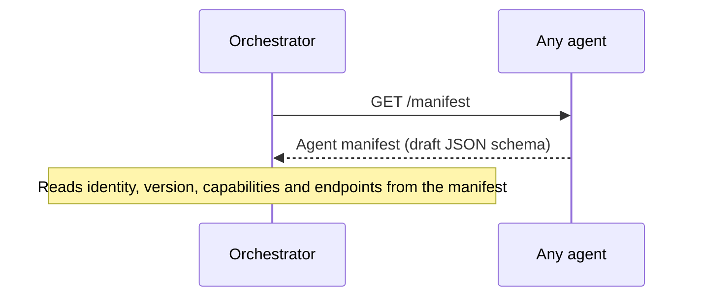
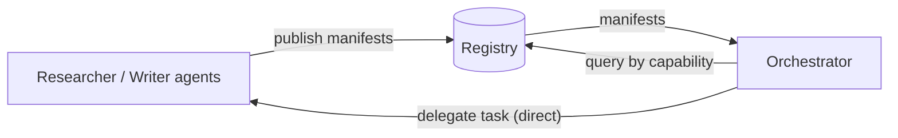

# Agent Discovery

> ⚠️ **Status:** draft design with a reference implementation. Since v0.2.0 the `agentmesh` package serves `GET /manifest` from every `agentmesh.Agent` and ships a simple registry (`agentmesh.Registry`, `agentmesh registry`). The manifest format is the Phase 1 draft in [`specs/manifest.schema.json`](../specs/manifest.schema.json) and is not finalized; capability matching is still an open question.

Before an Orchestrator can delegate work to a Researcher or Writer, it must find them. AgentMesh proposes discovery in two layers: **self-describing manifests** served by each agent, and a **registry** that indexes those manifests.

## The `/manifest` endpoint

Each agent exposes a `GET /manifest` endpoint that returns a JSON description of itself:



The manifest is expected to be cacheable (with a version field to detect changes) and includes, at minimum:

- **Identity:** name / unique agent ID.
- **Version:** the agent's own release version.
- **Capabilities:** what kinds of tasks the agent can accept.
- **Endpoints:** where to submit tasks and (if used) where results or webhooks are delivered.

Fetch and validate any agent's manifest from the command line:

```bash
agentmesh discover http://127.0.0.1:8001
```

## Capability advertisements

Capabilities are the core of the advertisement. A capability describes a *kind of work* (e.g., "research", "document-writing") together with hints about the input context it expects and the result shape it produces (`input_hint`, `output_hint`).

The goal of capability-driven advertisement is that an Orchestrator should be able to say *"find me an agent that can accept a research task defined by payload schema `X`"* without hard-coding agent names.

The reference registry matches capabilities by **exact `capability_id`**. Richer matching (schema references, versioned capabilities, ranking) is **Phase 1 work** — see [roadmap.md](roadmap.md).

## Registry-based discovery

A **registry** is an index of manifests:

1. **Publication:** agents publish their manifests to the registry when they start or update (`POST /agents`).
2. **Query:** a delegator (typically the Orchestrator) queries the registry by capability (`GET /agents?capability=...`).
3. **Resolution:** the registry returns manifests; the delegator then talks to the agent directly.



Properties of the design, all of which the reference registry follows:

- The registry is an **index**, not a broker — task traffic never flows through it.
- Registry entries are advisory; stale entries simply lead to a normal task failure or rejection, handled by the [task lifecycle](task-lifecycle.md).
- A single, simple registry service. Its HTTP API is documented in [http-api.md](http-api.md#registry-endpoints).

Reference agents started with `Agent.serve(registry_url=...)` register on start, re-register every 30 seconds (so a restarted, in-memory registry repopulates itself) and unregister on shutdown.

```bash
agentmesh registry --port 8500
agentmesh find http://127.0.0.1:8500 --capability research
```

## Direct / decentralized discovery (later versions)

The registry is a convenience, not a necessity, if manifests are discoverable by URL. Possible later evolutions (*open design questions, not plans*):

- **Direct manifest fetching** — an Orchestrator configured with agent URLs skips the registry entirely (already possible with `AgentClient(url).manifest()`).
- **Federated or peer-to-peer discovery** — agents sharing manifests with each other instead of relying on one central index.
- **Well-known locations** — conventions such as hosting a manifest at a fixed path on the agent's base URL.

## Related documents

- [protocol-overview.md](protocol-overview.md) — agent identity and manifest concepts.
- [http-api.md](http-api.md) — the reference HTTP binding.
- [architecture.md](architecture.md) — the registry's role in the system.
- [task-lifecycle.md](task-lifecycle.md) — what happens after discovery.
- [roadmap.md](roadmap.md) — what is done and what is next.
