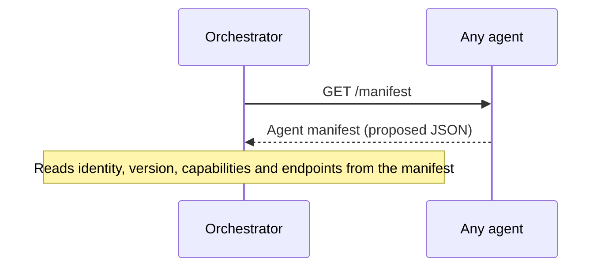
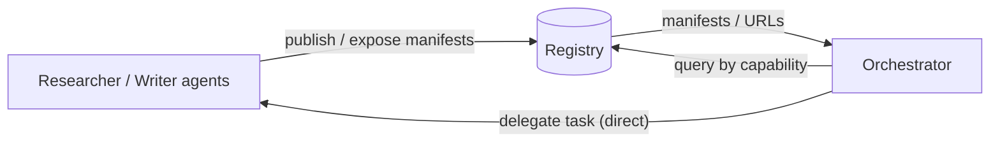

# Agent Discovery

> ⚠️ **Status:** Proposed design. The `/manifest` endpoint does not exist yet, and **no manifest schema is finalized here** — field names below are illustrative.

Before an Orchestrator can delegate work to a Researcher or Writer, it must find them. AgentMesh proposes discovery in two layers: **self-describing manifests** served by each agent, and a **registry** that indexes those manifests.

## The `/manifest` endpoint (planned)

Each agent exposes a `GET /manifest` endpoint that returns a JSON description of itself:

The manifest is expected to be cacheable (with a version field to detect changes) and to include, at minimum (*proposed, not finalized*):

- **Identity:** name / unique agent ID.
- **Version:** the agent's own release version.
- **Capabilities:** what kinds of tasks the agent can accept.
- **Endpoints:** where to submit tasks and (if used) where results or webhooks are delivered.

## Capability advertisements

Capabilities are the core of the advertisement. A capability might describe a *kind of work* (e.g., "web research", "document writing") together with the input context it expects and the result shape it produces.

The goal of capability-driven advertisement is that an Orchestrator should be able to say *"find me an agent that can accept a research task defined by payload schema `X`"* without hard-coding agent names.

Precise capability naming, schema references, and matching semantics are **Phase 1 work** — see [roadmap.md](roadmap.md). This document intentionally does not invent a finalized format.

## Registry-based discovery

A **registry** is an index of manifests:

1. **Publication:** agents publish their manifests (or manifest locations) to the registry when they deploy or update.
2. **Query:** a delegator (typically the Orchestrator) queries the registry by capability or other manifest attributes.
3. **Resolution:** the registry returns manifest data (or URLs); the delegator then talks to the agent directly.

Important properties (*proposed*):

- The registry is an **index**, not a broker — task traffic never flows through it.
- Registry entries are advisory; stale entries simply lead to a normal task failure or rejection, handled by the [task lifecycle](task-lifecycle.md).
- The initial design favors a single, simple registry service; its own API is Phase 2 work.

## Direct / decentralized discovery (later versions)

The registry is a convenience, not a necessity, if manifests are discoverable by URL. Possible later evolutions (*open design questions, not plans*):

- **Direct manifest fetching** — an Orchestrator configured with agent URLs skips the registry entirely.
- **Federated or peer-to-peer discovery** — agents sharing manifests with each other instead of relying on one central index.
- **Well-known locations** — conventions such as hosting a manifest at a fixed path on the agent's base URL.

These are noted as future design space; nothing in this repository currently implements any discovery mechanism.

## Related documents

- [protocol-overview.md](protocol-overview.md) — agent identity and manifest concepts.
- [architecture.md](architecture.md) — the registry's role in the system.
- [task-lifecycle.md](task-lifecycle.md) — what happens after discovery.
- [roadmap.md](roadmap.md) — when the manifest schema will be drafted (Phase 1–2).
