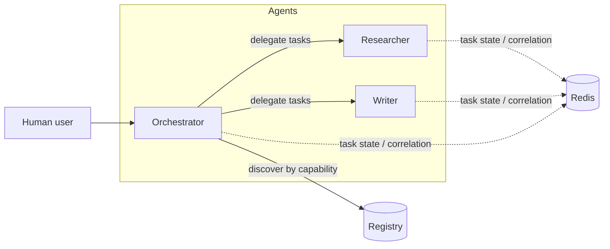

# Architecture

> ⚠️ **Status:** This is a design document for a proposed system. AgentMesh is in its early design and scaffolding phase; nothing described here is implemented.

## High-level architecture

AgentMesh proposes a network of **independent agent services** that cooperate over network APIs:

- Each agent (for example, an **Orchestrator**, **Researcher**, or **Writer**) is a separately deployed service with its own lifecycle, owned API, and LLM runtime of its choosing.
- Agents do not share processes, memory, or application state. Coordination happens exclusively through protocol messages.
- A **registry** indexes agent **manifests** so that any agent can discover which other agents exist and what capabilities they advertise.
- **Redis** is the planned backing store for *transient* task state and conversation correlation — not a system of record.

## Independent agent services

Every participating agent is expected to expose, at minimum (as proposed):

1. A **manifest endpoint** (planned: `/manifest`) describing identity and capabilities. See [agent-discovery.md](agent-discovery.md).
2. A **task interface** for accepting task submissions and reporting results, following the payload conventions in [protocol-overview.md](protocol-overview.md).
3. Its own execution runtime (LLM or otherwise). AgentMesh is model-agnostic: the protocol does not care whether an agent runs LiteLLM, Ollama, or something else.

Agents are peers. The Orchestrator is distinguished by *role* (it plans and delegates), not by special protocol privileges: the Researcher could, in principle, delegate sub-tasks the same way.

## The registry

The registry is a discovery index, not a message broker:

- Agents **publish or expose** manifests describing capabilities.
- Consumers (typically the Orchestrator) **query** the registry by capability to find candidate agents.
- The registry is *advisory*: if an agent's manifest is stale, task delegation may still fail, and that failure is a normal protocol outcome (see [task-lifecycle.md](task-lifecycle.md)).

A registry-less mode — direct manifest fetching by URL — is also part of the design space; decentralized discovery is a possible later evolution. See [agent-discovery.md](agent-discovery.md).

## The Orchestrator

The **Orchestrator** receives a goal from a human user, decomposes it into tasks, discovers capable agents, delegates each task, and assembles the results (for example, passing the Researcher's output to the Writer, and returning the final report to the user). It tracks task and conversation state so that asynchronous results can be correlated back to the originating request.

## Task communication

Task communication is designed to be **asynchronous by default**:

1. The delegator submits a task payload containing a **task ID**, a **conversation ID**, context, and constraints.
2. The receiving agent accepts the task (or rejects it) and processes it independently.
3. The delegator learns the outcome via **webhooks or polling** over REST.
4. **Redis** (planned) backs the transient state that makes this correlation work: task status, conversation threads, and pending callbacks.

Redis's role is intentionally narrow: it is for short-lived, coordination-related state. Durable storage of results is out of scope for the initial design.

## Protocol vs. implementation

AgentMesh deliberately separates:

- **The protocol** — the vocabulary of manifests, task payloads, conversations, results, and errors; expressed in `specs/` and the documents in `docs/`. It is language- and model-agnostic.
- **The implementation** — a concrete reference stack (currently *proposed*: Python + FastAPI, Redis, LiteLLM/Ollama, REST + webhooks/polling). The implementation must conform to the protocol; the protocol must not depend on the implementation.

This separation is what should eventually let an agent written in any language, with any model, join a mesh without changing how the rest of the mesh works.

## Related documents

- [protocol-overview.md](protocol-overview.md) — proposed payload concepts.
- [agent-discovery.md](agent-discovery.md) — manifests and registry discovery.
- [task-lifecycle.md](task-lifecycle.md) — conceptual task lifecycle.
- [roadmap.md](roadmap.md) — phased plan.
