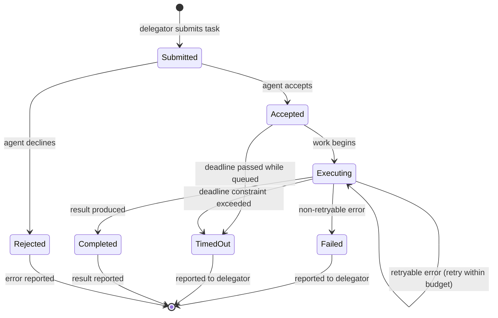

# Task Lifecycle

> ⚠️ **Status: draft, with a reference implementation.** The lifecycle below is a *proposal* that still guides Phase 1 specification work, so states, transitions and names may change. Since v0.2.0 the `agentmesh` package implements it: `agentmesh.lifecycle` enforces the transitions and the reference agent (`agentmesh.Agent`) follows them. Reference behaviour is described in [Reference implementation](#reference-implementation) below.

Every unit of delegated work in AgentMesh is a **task**: a single payload carrying a `task_id`, a `conversation_id`, context, and optional constraints. This document describes the states a task is expected to move through between delegation and outcome.

## Proposed states

| State | Meaning |
| --- | --- |
| `Submitted` | The delegator has sent the task payload; no acceptance yet. |
| `Accepted` | The agent has acknowledged the task and committed to attempting it. |
| `Rejected` | The agent declined without executing (e.g., unsupported capability, constraint it cannot honor). |
| `Executing` | Work in progress; the agent may report progress. |
| `Completed` | A structured result is available. |
| `Failed` | The task ended with a structured error; terminal. |
| `TimedOut` | A deadline constraint was exceeded, either during execution or while the task was still queued; terminal (re-submission is the delegator's choice). |

## Lifecycle stages

### 1. Task submission

- The delegator builds a task payload with a **task ID** and, for multi-step workflows, a **conversation ID** shared by related tasks (see [protocol-overview.md](protocol-overview.md)).
- Submission is a network API call to the receiving agent's task endpoint (transport: REST; see [http-api.md](http-api.md)).

### 2. Acceptance

- The receiving agent validates the payload: is the capability recognized? Are constraints honor-able?
- **Accept** → the task proceeds; **Reject** → the agent returns a structured error promptly, ideally explaining why (non-retryable `Rejected` outcome).
- Explicit rejection is preferred over silent acceptance followed by later failure.

### 3. Execution

- The agent performs the work (with its own model/runtime — invisible to the protocol).
- Optional **progress events** may be emitted to the delegator (mechanism not yet specified: likely polling or webhooks).

### 4. Completion

- On success, the agent returns a **result** payload referencing the originating `task_id` / `conversation_id` (see [protocol-overview.md](protocol-overview.md)).

### 5. Failure

- On a non-retryable error, the agent returns a structured **error** payload (machine-readable code + message, retryability hint).
- The task is terminal; the delegator decides whether to surface the error, re-plan, or delegate the work elsewhere.

### 6. Timeout

- If a **deadline constraint** was supplied and exceeded, the task transitions to `TimedOut` rather than hanging indefinitely.
- Timeout handling is the delegator's tool for bounding asynchronous work; exact default behaviors (who owns the timer, notification semantics) are *open design questions*.

### 7. Retries

- Transient errors (e.g., a failing upstream LLM provider) may be retried **by the executing agent** within a retry budget, without changing the `task_id`.
- The delegator may also choose to re-submit failed/timed-out tasks as **new tasks** (new `task_id`, same `conversation_id`) — preserving the workflow correlation while keeping attempts distinguishable.
- Precise retry semantics (budgets, backoff, idempotency guarantees) are **Phase 1 specification work** and intentionally left open here.

## Asynchronous reporting

Because execution is asynchronous, outcome reporting is expected to happen via **webhooks or polling** over the task/execution state store (planned: Redis-backed in Phase 4 — see [architecture.md](architecture.md)). The delegator correlates outcomes by `task_id`.

## Reference implementation

How `agentmesh.Agent` (v0.2.0) resolves the open points today. These are implementation choices, not yet protocol rules:

- **Who assigns `task_id`:** the delegator. `agentmesh.new_task()` and `AgentClient.delegate()` generate one when none is given.
- **Idempotency:** re-submitting an identical payload with the same `task_id` returns the existing task; a different payload with the same `task_id` is refused (`409 duplicate_task`).
- **Deadlines:** the effective deadline is the earlier of `constraints.deadline` and acceptance time + `constraints.timeout_seconds`. The agent owns the timer: a task that is still `accepted` or `executing` when it passes becomes `timed_out` (error code `deadline_exceeded`, `retryable: true`), and a late result is discarded.
- **Retries:** a handler signals a transient failure with `TaskFailure(..., retryable=True)`; the agent retries up to `max_retries` times (default 0) before reporting `failed`.
- **Progress reporting:** polling only, via `GET /tasks/{task_id}`. Webhooks remain Phase 4 work.
- **State storage:** in memory, per agent process. Redis-backed state remains Phase 4 work.

## Open questions (to resolve in the specification)

- Who assigns `task_id` — delegator or executor?
- Idempotency: is re-submitting the same `task_id` guaranteed to be de-duplicated?
- How progress events are framed (polling endpoint shape, webhook payload schema).
- Default constraints (e.g., minimum timeout) and constraint negotiation.

## Related documents

- [protocol-overview.md](protocol-overview.md) — payload fields referenced above.
- [http-api.md](http-api.md) — the reference HTTP binding and error codes.
- [agent-discovery.md](agent-discovery.md) — finding the agent to submit to.
- [architecture.md](architecture.md) — Redis's role in task state.
- [roadmap.md](roadmap.md) — when this lifecycle gets specified and implemented.
